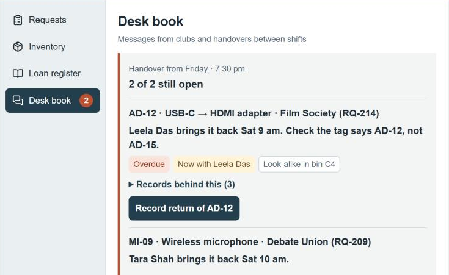

# Campus Stores

Campus Stores is a Product Engineer work sample set at a fictional campus media equipment desk. Work through a club’s screening, from equipment pickup to a partial return and the next morning’s handover. Open **Candidate brief** in the app for the assignment.

## Reviewer notes: a handover drafted from the records

**Would I keep this product? Yes, with one change to how a shift hands over.**

**In short**
- **Keep:** one slip per physical unit, with checks that stop the wrong unit, or one too many, leaving the desk.
- **Change:** the 7:30 pm handover. Instead of writing a blank note from memory, the clerk checks a handover drafted from the slips and messages. The morning shift then works from it as a checklist.
- **Measured:** `node eval/handover.eval.js` scores the draft on 8 shifts and the message reader on 8 everyday messages, including the ones it still gets wrong.
- **Try it in a minute:** issue the three Film Society units to Kabir and move to 7:30 pm. Record the projector and speaker returns, follow *Open handover*, tick both lines and sign off. Then move to the next morning.



Where to look:
- `handover.js`: the drafter, a pure function over the desk's records.
- `app.js`: the Desk book handover, its live status and the register hint.
- `eval/handover.eval.js`: the evaluation, in two parts: drafting the handover, and reading messages. Run it with `node eval/handover.eval.js`.

### A moment it handles well

At the 3:45 pm pickup I issued RQ-214 as three slips in Kabir Sen's name, as Isha's desk book message asked. The slip form only offered units that were free and not in repair, so PR-06 never appeared. When I tried a second adapter on the same request it refused: "The approved quantity of this equipment type is already on loan." Because every physical unit has its own slip, the 7:30 pm partial return works at all: I could close PR-04 and SP-02 and leave the adapter open. All of this is unchanged.

### The moment I would change

At 7:30 pm the brief says to take the return and hand over to the morning shift. The product gives the clerk a blank *Note for the next shift* box. Everything the morning needs is already in the records, but in three places:
- The adapter slip still says Kabir Sen, due Fri 8 pm.
- Kabir's desk book message says Leela Das has it and will come at 9 am.
- The inventory shows a different adapter, AD-15, in the same bin, C4.

The clerk has to rebuild that from memory at the end of a shift. On Saturday the incoming clerk gets that free text, or nothing. They also see two outstanding slips identified by codes, and neither one mentions Leela.

This is the nurse handover from the job description at desk scale. The facts exist in the day's records, but the handover is written from memory, so things get missed.

### Why this change, not a slip-level fix

I first prototyped the obvious fix: record a new holder and expected time on the slip, and check the tag on every return. I dropped it because it still depends on the outgoing clerk remembering to update the right slip at the end of a shift, and that is the step that fails. The facts are already in the records, and nobody is putting them together. So the draft puts them together, and the clerk checks it. Checking is the faster and more reliable job for a person at the end of a shift.

### The change

1. **The handover is drafted from the records.** On the Desk book, the blank box becomes a draft built from the slips, units, requests and messages. It has one line for each slip the next shift has to act on. Each line quotes its source and carries warnings:
   - *Overdue*
   - *Now with …*
   - *Look-alike in bin …*
   - Two checks for records that disagree: *Said returned, slip open* and *Slip closed, item still out*.
2. **The clerk checks it; the software does not decide.** Every line has to be ticked before *Sign off handover*. The clerk can add to or correct any line, and add anything else. The draft never edits a slip. When a message and a slip disagree, it shows both.
3. **The handover stays live for the next shift.** Each line leads with the next step, for example "Leela Das brings it back Sat 9 am. Check the tag says AD-12, not AD-15." The records behind it are one click away. The morning clerk sees "Handover from Friday · 7:30 pm · 2 of 2 still open". Each line closes itself when its slip closes, and offers *Record return of AD-12* right under the tag check. The Loan register links to it: at 7:30 pm it says the handover is not signed yet, and in the morning it shows how many items are still open.
4. **An evaluation measures what the draft gets wrong.** `eval/handover.eval.js` runs the drafter on eight Friday-night desks that each have a known right answer:
   - the shift as played
   - the clerk closes all three Film Society slips
   - a return is never recorded
   - the kit is issued in Isha's name
   - the other adapter goes out
   - Kabir leaves no message
   - the microphone comes back early
   - a message in everyday wording

   It counts missed items, false alarms, wrong holder, wrong time and wrong warnings. Current result: 7 of 7 core desks are drafted correctly, with 74 of 76 checks passing, no missed items and no false alarms. The two failed checks are both in the everyday-wording desk, which is recorded as a known gap: "Leela's holding onto the dongle till tomorrow morning" gets past the reader.

   A second part gives the message reader eight everyday messages on their own. They include rewordings, a nickname, a pronoun, a Hindi-English message, and two harmless messages that must not create a holder. Current result: 4 of the 8 are read correctly, no holders are invented, and the other 4 are recorded as known gaps.

   The eval has already changed the code once. A probe showed the reader turning "Leela asked if she can borrow the adapter tomorrow" into "Now with Leela Das", a confident wrong answer. That message is now in the eval, and the reader only accepts a holder when the sentence says they have it ("has", "is with", "stays with").

### The same job, using it

- **Fri 3:45 pm:** issue PR-04, SP-02 and AD-12 to Kabir Sen, as before. The Desk book says the handover will be drafted there at the end of the shift.
- **Fri 7:30 pm:** record the returns of PR-04 and SP-02. The register says "Handover not signed yet: 2 items drafted from the records", so I follow *Open handover*. The draft has two lines:
  - AD-12 leads with "Leela Das brings it back Sat 9 am. Check the tag says AD-12, not AD-15." It is marked *Overdue · Now with Leela Das · Look-alike in bin C4*, with Kabir's message quoted underneath.
  - MI-09 leads with "Tara Shah brings it back Sat 10 am." and quotes Tara's message.

  I tick both and sign off. If I had forgotten to record the speaker, or had closed the adapter slip by mistake, the draft would have said so.
- **Sat 9:00 am:** the register says "Handover from Friday · 7:30 pm: 2 items still open." The handover tells me Leela is bringing AD-12, and that AD-15 looks the same. I check the tag and press *Record return of AD-12*. The handover now reads "1 of 2 still open", and the microphone is due at 10.

### What I kept

I kept per-unit slips and the issue checks, the register, the desk book messages, the visual language, and offline, local-only data. Issuing and returning are unchanged. Shifts saved by the original version still load.

### One observation at a real counter

Watch the first ten minutes of the morning after a partial return. When the late item comes in, does the incoming clerk go from the handover straight to the right slip, check the tag and close it, without asking anyone or reading back through the desk book? If they do, the handover carried the job across the shift. If they still ask around, it did not.

To follow it over a week of shifts, I would also count:
- **Morning surprises:** open items or messages the handover did not mention. The target is zero.
- **Handover time:** from opening the Desk book to sign-off. The target is under a minute.

### Failure cases and next steps

- The message reader is rule-based, so it misses everyday wording: pronouns, nicknames like "mic", and Hindi-English messages, which a counter in Hyderabad will see every day. In production this is the step for a language model. It would read each message into the same claim shape: unit, returned or out, holder, expected time, and quote. The same eval would score it, and each known gap would join the main set once it passes.
- The draft can be wrong, so it never writes to a slip. Disagreements are shown rather than resolved, and every line needs a tick from the clerk.
- Messages contain people's names. The draft uses only the day's slips and desk messages, and nothing leaves the browser in this prototype.

### Noticed, deliberately not changed

To keep this to one change, I left these alone:
- *Restart sample shift* has no confirmation.
- The issue form makes you re-pick everything for each unit.
- The request page shows "Filed by Isha Rao", which makes it easy to issue the kit to Isha instead of Kabir.
- Returns are one click with no tag check. For now, the handover line names the tag to check.

## Run the app

Open `index.html` in a modern browser. The app includes its scripts, styles, and icons and can run offline.

To serve it over local HTTP, run this from the repository folder and visit `http://localhost:8000`.

```sh
python3 -m http.server 8000 --bind 127.0.0.1
```

Each browser stores its own sample shift locally when browser storage is available. **Restart sample shift** restores the fictional starting records.

## Source

- `index.html` contains the desk layout, candidate brief, and bundled icons.
- `app.js` contains the sample records and interactions.
- `styles.css` defines the desktop and mobile layouts.
- `handover.js` drafts the shift handover from the desk's records.
- `eval/handover.eval.js` scores the draft against shifts with a known right answer, and the message reader against everyday messages. Run it with `node eval/handover.eval.js`.

Icon license notices are in [third-party/lucide-LICENSE.txt](third-party/lucide-LICENSE.txt).


## Submit your work

1. [Fork Campus Stores](https://github.com/virinchi-healthcare/campus-stores/fork) into your GitHub account. Complete the candidate brief and push your changes to your public fork. In your README, point reviewers to your work and explain the decision you made.
2. In your fork, open **Commits**, select the final commit you want reviewed, and copy the page URL. It should look like `https://github.com/YOUR-USERNAME/campus-stores/commit/COMMIT-SHA`.
3. [Submit your work through the Google Form](https://docs.google.com/forms/d/e/1FAIpQLScvzoh1R4WS-SkiwAVBQbMvniieJYSoOEfLMyVo5CyjOvYUgQ/viewform). Your **roll number**, **email ID**, and **final commit link from your public fork** are required. Enter your roll number and email ID in the form only.
